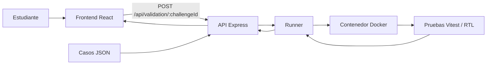
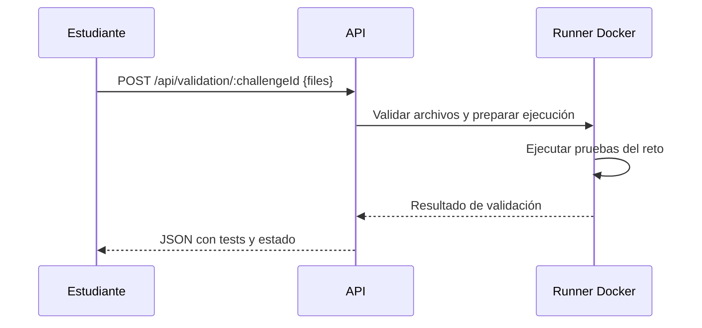

# Arquitectura — BugLab

## Visión general

BugLab separa la interfaz de aprendizaje (React, Vite y TypeScript) de la API de validación (Node.js, Express y TypeScript). Los desafíos y sus archivos están definidos en el backend; el runner utiliza Docker para ejecutar las pruebas del caso y devolver los resultados.

## Componentes

| Componente | Ubicación | Función |
| --- | --- | --- |
| Interfaz | `frontend/src` | Presentar retos, editor y resultados |
| API | `backend/src/server.ts` y `backend/src/routes` | Exponer casos y validaciones |
| Runner | `backend/src/services/runner.service.ts` | Preparar y ejecutar el entorno de validación |
| Casos | `backend/challenges/BUG-001..003` | Metadatos, código y pruebas de los retos |

## Flujo de validación

El payload contiene una lista de archivos editados con `path` y `content`. Las rutas permitidas se determinan a partir de la configuración del desafío. El contenedor devuelve la información que el backend utiliza para reportar el resultado.

## Advertencia de seguridad

El uso de Docker y las validaciones de rutas son medidas parciales. Esta versión **no debe desplegarse como servicio público de ejecución de código no confiable** sin implementar y verificar los controles señalados en [aprendizajes y limitaciones](lessons-learned.md).
